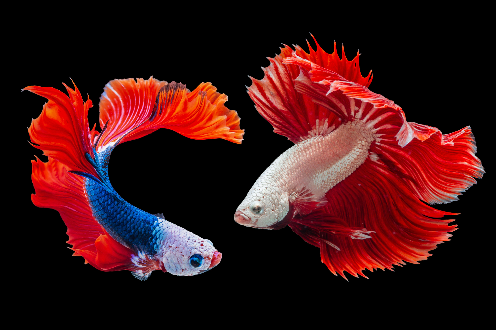
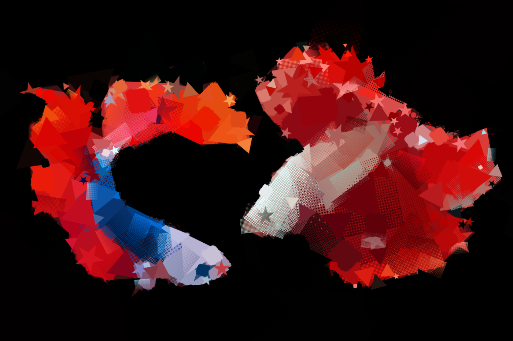
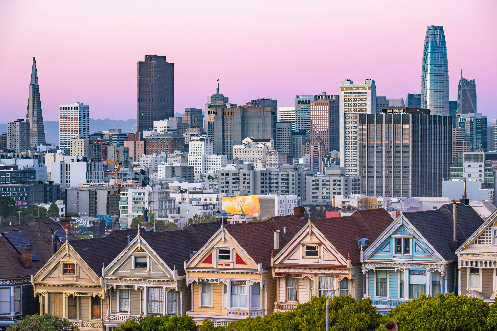
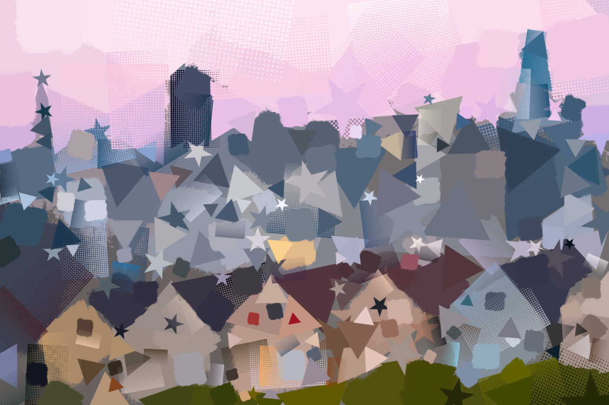
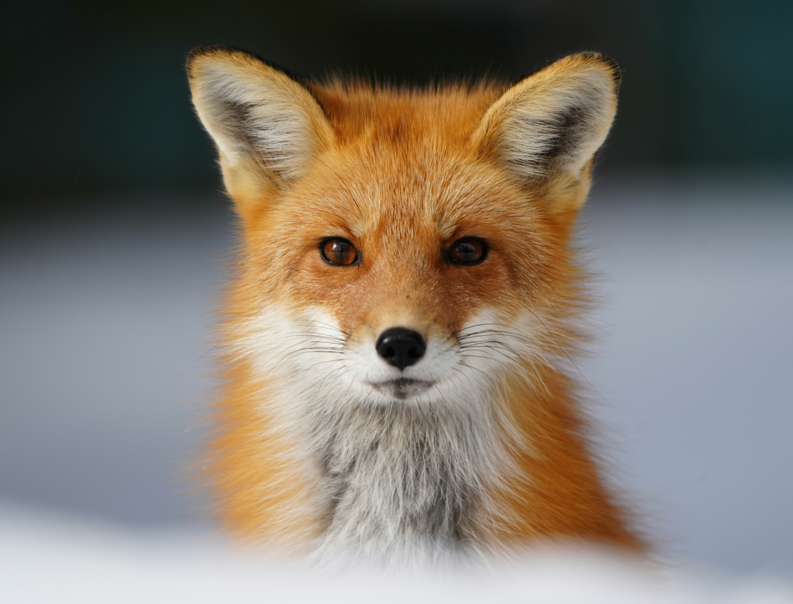
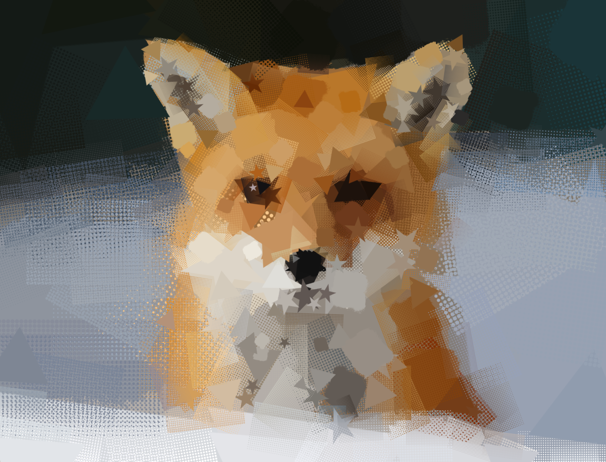
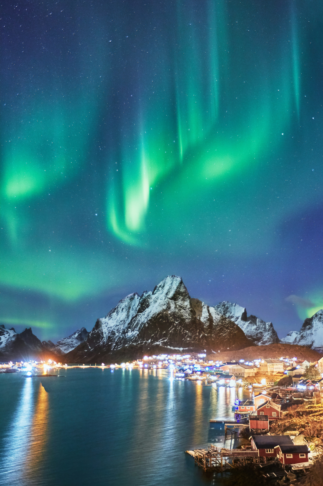
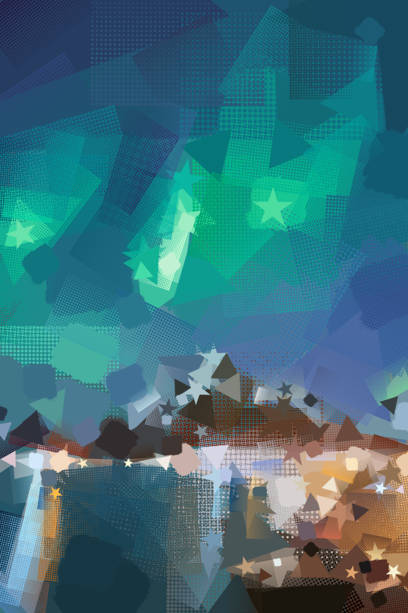

# Collaginator! An Image Approximator with Genetic Patches

## Demos
|**Target Image**                                   |**Collaged**                                       |
| ------------------------------------------------- | ------------------------------------------------- |
|         |  |
|  | |
|                   |            |
|               |         |

## How to use
#### Firstly [Install Python](https://www.python.org/downloads/) (If you haven't already)

1. **Clone the repo**
```bash
git clone https://github.com/Roark-G/image-approximator
cd image-approximator
```
2. **Install requirements**
```bash
pip install -r requirements.txt
```
3. **Run the approximator**
```bash
python3 main.py TARGET [--n-patches N] [--patches DIR] [--start-mode MODE] [--verbose]
```

For example, to collage `vinicunca.jpg` with 300 patches from the basic palette:
```bash
python3 main.py demos/target_images/vinicunca.jpg --n-patches 300 --patches patch_palettes/basic_palette --start-mode average --verbose
```

| Argument | Required | Default | Description |
| - | - | - | - |
| `TARGET` | yes | N/A | path to the image you want to approximate |
| `--n-patches N` | no | `200` | number of patches to place; more patches look closer to the target but take longer |
| `--patches DIR` | no | `patch_palettes/basic_palette` | folder of PNG patches to build the collage from (transparency defines each patch's shape) |
| `--start-mode MODE` | no | `average` | what the canvas starts as: `white`, `average` (the target's average color), or a path to a starting image |
| `--verbose` | no | off | print a line for each patch placed (`[N/TOTAL patches \| %]`); without it, a one-line progress bar is shown |

Included is demo.ipynb, which gives a simple overview of how to perform basic functions such as collaging with multiple images.

## Key Methods

### `ImageApproximator.run(target, patches_dir, n_patches=200, parameters=None, notebook=False, verbose=True)`
#### Runs the approximator with a given image and given patches for `n_patches`

| Parameter | Type | Default | Description |
| - | - | - | - |
| `target` | `str \| np.ndarray` | N/A | filepath of the target image to evaluate the fitness of patches against or BGR numpy array |
| `patches_dir` | `str` | N/A | folder or list of folders of PNG patches to collage with |
| `n_patches` | `int` | `200` | number of patches to add to the canvas; a proxy for "quality" since more tends to look closer to the target image |
| `parameters` | `RunParameters` | `RunParameters()` | `RunParameters` [object to specify technical parameters about the run](#Parameters) |
| `notebook` | `bool` | `False` | highly recommended when running in a jupyter notebook, renders the canvas as it is added using `ipython` |
| `verbose` | `bool` | `True` | disabled if `notebook` is set to `True`; False still prints out a minimal progress bar. True prints out progress along with measures like fitness etc. |

### `ImageApproximator.export_img(filepath, dpi=300, longest_edge=1400)`
#### Exports the canvas as an image

| Parameter | Type | Default | Description |
| - | - | - | - |
| `filepath` | `str` | N/A | filepath of where to save the exported image |
| `dpi` | `int` | `300` | dpi metadata associated with the exported image |
| `longest_edge` | `int \| None` | `1400` | longest_edge (in pixels) of the exported image; `longest_edge=None` saves at the canvas size |

### `ImageApproximator.export_animation(filepath, fps=12, longest_edge=1400)`
#### Exports the animation as a video.

| Parameter | Type | Default | Description |
| - | - | - | - |
| `filepath` | `str` | N/A | path to save the output video (`.mp4` or `.avi`) |
| `fps` | `int` | `12` | frames per second of the output video |
| `longest_edge` | `int \| None` | `1400` | longest_edge (in pixels) of the exported image; `longest_edge=None` saves at the canvas size |

### `ImageApproximator.export_json(filepath)`
#### Exports the canvas as json data, with patch data stored as referenced filepaths
| Parameter | Type | Default | Description |
| - | - | - | - |
| `filepath` | `str` | N/A | filepath of where to save the exported json |

###  `ImageApproximator.load_json(filepath, patch_dirs=None)`
#### Loads the canvas from json data. If the json or patches are moved, you will need to provide a `patches_dirs`
| Parameter | Type | Default | Description |
| - | - | - | - |
| `filepath` | `str` | N/A | filepath of the json to load from |
| `patch_dirs` | `str \| list[str]` | `None` | extra folders to search for patch files if the saved paths no longer resolve |

## File Structure
| File | Description |
| - | - |
| `main.py` | runs the cli for the approximator |
| `demo.ipynb` | contains demo code for how to use the approximator object |
| `image_approximator.py` | python file containing the approximator algorithm and other objects described in this README |
| `demos` | contains the images used for the demos at the top of this README |
| `progress_bar.py` | handles the progress bar |
| `patch_palettes/` | some patch palettes used for the demo collages |
| `patch_palettes/basic_palette` | a basic palette of patches |

## Parameters
#### These are contained within `RunParameters`
| Parameter | Type | Default | Description |
| - | - | - | - |
| `start_mode`            | `str`          | `"average"` | initial canvas appearance on the first run: white, target image average color, or a specified image path |
| `allow_angle`           | `bool`         | `True`      | allow patches to rotate                                                                                  |
| `allow_recolor`         | `bool`         | `True`      | allow patches to change color                                                                            |
| `max_recolor_intensity` | `float`        | `1.0`       | maximum intensity of patch recoloring                                                                    |
| `perfect_color`         | `bool`         | `True`      | solves for exact color for each candidate; disable if wanting a less accurate but more organic feel |
| `allow_resize`          | `bool`         | `True`      | allow patches to change size                                                                             |
| `start_min_patch_size`  | `float`        | `0.1`       | minimum patch size at the beginning of a run                                                             |
| `start_max_patch_size`  | `float`        | `1.0`       | maximum patch size at the beginning of a run                                                             |
| `min_patch_size`        | `float`        | `0.0`       | minimum patch size at the end of a run                                                                   |
| `max_patch_size`        | `float`        | `0.2`       | maximum patch size at the end of a run                                                                   |
| `find_patch_pop_size`   | `int`          | `100`       | number of candidate patches evaluated per generation                                                     |
| `search_resolution`     | `int \| None` | `256`       | longest edge of the search canvas in pixels; `None` uses the full canvas resolution                      |
| `patch_init_pixel_size` | `int`          | `1`         | pixelation block size of the error heatmap used to seed candidate positions; larger values spread starting positions more evenly |
| `survival_proportion`   | `float`        | `0.25`      | fraction of candidate patches retained for the next generation                                           |
| `early_stop_eps`        | `float`        | `1e-3`      | minimum improvement required to continue optimization; measured in MSE on a 0–255 scale |
| `early_stop_patience`   | `int`          | `15`        | number of consecutive generations without sufficient improvement before stopping                         |
| `min_generations`       | `int`          | `10`        | minimum number of generations to run before early stopping is allowed                                    |
| `max_patch_generations` | `int`          | `100`       | maximum number of generations per patch search                                                           |
| `mutation_chance`       | `float`        | `0.15`      | probability that an individual gene is mutated                                                           |
| `mutation_std`          | `float`        | `0.05`      | standard deviation of random gene mutations                                                              |
| `preview_longest_edge`  | `int \| None` | `400`       | longest edge of the live preview in pixels; `None` displays the search canvas at its native resolution   |
| `preview_every`         | `int`          | `1`         | refresh the live preview after every N patches                                                           |

Note: The four patch-size parameters define linearly changing size bounds throughout a run, transitioning from the starting range to the ending range